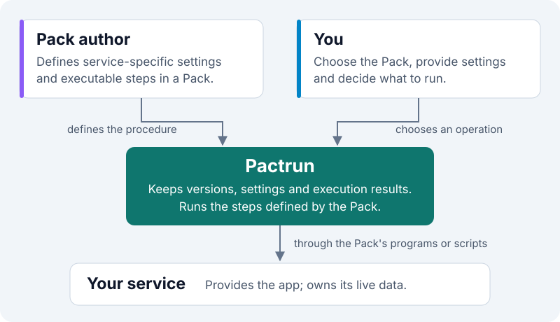

# Pactrun

**Keep the service. Make its upkeep repeatable.**

[Documentation](https://pipapoen.github.io/pactrun/) · [Install](#install) · [Preview releases](https://github.com/Pipapoen/pactrun/releases) · [Write a Pack](./docs/package-authors/index.md)

[](https://github.com/Pipapoen/pactrun/releases/tag/v1.0.0-alpha.9)
[](https://github.com/Pipapoen/pactrun/actions/workflows/ci.yml?query=branch%3Amain)
[](./docs/guides/installation.md)
[](./LICENSE)
[](https://github.com/Doner357/AGAIN)

Pactrun is a command-line tool for managing local services using a **Pack**: a
versioned set of instructions that describes the service's settings and how to
operate it. Use a Pack someone has prepared, or write one for your own service.
Pactrun runs as a single executable on Windows and Linux.

## Why Pactrun?

Starting a service can be easy. Keeping track of it over time is a different job:
which settings belong to this copy, which steps to run, what happened last time,
and what needs to be preserved when it changes.

Pactrun gives those recurring tasks a common place:

- **Keep each setup identifiable.** Create a named **Instance**, a managed use of
  an installed Pack version, with its own configuration.
- **Discover operations instead of remembering commands.** List what the Pack
  provides, inspect an operation's plan, then decide whether to run it.
- **Understand what happened.** Inspect execution results and diagnostics rather
  than relying only on the last terminal session.
- **Handle changes deliberately.** Use backup, restore, migration and cleanup
  operations when the Pack defines them, with their service-specific limits.

The Pack supplies the service knowledge. Pactrun supplies the shared management
and execution model. You do not need to write a Pack just to use one.

## Who does what?



- **The author** defines the Pack and its executable steps, called **Hooks**.
  These are programs or scripts that know how to work with the service.
- **You** choose what to install, supply configuration and decide which operations
  to perform.
- **Pactrun** keeps installed versions and managed configuration, coordinates
  executions and records their results.
- **The service** provides the application and manages its live data. Its backup
  and upgrade requirements still matter.

Packs execute code on your machine. Use Packs and Hooks you trust; Pactrun is
**not a security sandbox or a secret vault**.

## Where it fits

**Pactrun manages how you operate a service, not just how you start it.** It keeps
the Pack version, configuration and execution history together for each Instance.
The service-specific work still belongs to the Pack and the tools it uses.

| Existing approach | What it already does | What Pactrun adds |
| --- | --- | --- |
| **Service CLI, Shell or PowerShell scripts** | Run the service's commands and automate the steps you need. | Package those procedures with declared configuration and named operations. Keep each Instance's selected Pack version, settings and execution results without rebuilding that management layer in every script collection. |
| **Service managers, such as systemd** | Start and stop services, manage startup dependencies and supervise processes. | Manage the configuration and maintenance operations around a service. A Pack can call the service manager; ongoing supervision stays with that manager. |
| **Docker / Compose** | Run containers and describe an application's services, networks and volumes; manage their lifecycle and inspect logs. | Expose service-specific operations through a Pack, with configuration and execution history per Instance. The same management model also applies to native services, without requiring containers. |


These are complementary responsibilities, not mutually exclusive choices. One
Pack might call a service's backup command and use a service manager to stop and
restart it; another might call Docker Compose. Those integrations come from the
Pack, not built-in knowledge of every service in Pactrun.

Pactrun provides mechanisms for backup, restore, migration and cleanup; **the
Pack must define the service-specific procedure and its limits**. Installing a
Pack does not make arbitrary backups consistent or every upgrade reversible.
Pactrun is not an always-on daemon, scheduler or remote orchestrator, and it does
not replace process supervision or a container runtime.

**What about integrated self-hosting platforms?**
[YunoHost](https://doc.yunohost.org/admin/what_is_yunohost/) already handles
application installation, upgrades, backups and restores through its
[app packages](https://doc.yunohost.org/en/dev/packaging/). It combines that with
web administration, users, domains and certificates in a Debian-based platform.

Pactrun has a narrower scope: a standalone command-line tool for Pack-defined
operations on Windows and Linux, without a built-in hosting control panel or
shared user/domain management. Choose an integrated platform when you want those
pieces managed together. Consider Pactrun when you want versioned operating
procedures without adopting a complete hosting platform; service integration and
maintenance logic still need to be supplied by the Pack.

**When can you skip Pactrun?** If a few commands, an existing hosting platform or a Compose setup
already cover your needs, keep using them directly. Pactrun becomes more useful
when you want to hand repeatable operations to other people, manage several
Instances with different settings, or inspect maintenance history through one
consistent interface. Docker and WSL are not universal prerequisites; the Pack
determines which tools are needed.

## Install

**Current release: Preview `1.0.0-alpha.9`.** Evaluate it with isolated data before
using it for anything important. There is no Stable release yet.

These commands assume Git and the relevant package manager are already available.
The published packages target **Windows x86-64** and **Linux x86-64 with glibc 2.36
or newer**. The Preview executables are unsigned; use the project-owned source
and follow the [installation prerequisites](./docs/guides/installation.md).

### Windows · Scoop

```powershell
scoop bucket add pactrun https://github.com/Pipapoen/pactrun
scoop install pactrun/pactrun-preview
pactrun --version
```

### Linux · Homebrew

```sh
brew tap pipapoen/pactrun https://github.com/Pipapoen/pactrun
brew install pipapoen/pactrun/pactrun-preview
pactrun --version
```

Already installed? See [version management](./docs/guides/version-management.md).
If you use the old `doner357/pactrun` tap, follow the
[existing-installation guidance](./docs/guides/installation.md#existing-installations-from-doner357)
instead of adding a duplicate. For a separate unmanaged copy, use the
[standalone archives](./docs/guides/standalone-installation.md).

## Use a Pack

Get a trusted Pack from its author and check its service requirements. In this
example, replace `./supplied.pack` with the actual file. Choose unused local names
instead of reusing `app`, `initial` or `demo` if they already identify other work.

```text
pactrun pack install ./supplied.pack --package-name app --revision-name initial
pactrun revision show app:initial
pactrun instance create demo --revision app:initial
pactrun action list demo
```

Here, `app:initial` names the installed Pack version; `demo` is the Instance you
will manage. Installing the Pack and creating the Instance do **not** automatically
start a service. Creation may allocate declared service storage.

Next, follow the Pack author's instructions to supply required configuration and
choose an operation from the list. Each Pack exposes its own operations; there
is no universal `start` command. See the [step-by-step user guide](./docs/guides/use-pack.md)
and [planning and running an operation](./docs/guides/run-and-diagnose.md).

<details>
<summary><strong>Using Pactrun from scripts?</strong></summary>

Use `--format json` for one complete response, or `--format jsonl` for streamed
events followed by a result. Both default to `format: "pactrun.cli"` and
`format_version: "1.0-alpha.4"`. See the
[machine-output reference](./docs/pactrun-users/reference/operation-output.md)
for schemas, compatibility and output-handling details.

</details>

## Keep exploring

| Your next step | Start here |
| --- | --- |
| Use an existing Pack | [User guides](./docs/guides/index.md) |
| Turn your service's procedures into a Pack | [Pack author guide](./docs/package-authors/index.md) |
| Look up a command or output field | [User reference](./docs/pactrun-users/reference/index.md) |
| Read the exact behavior and formats | [Specification](./docs/spec/index.md) |

## Contributing & license

Pactrun is written in Rust. See [CONTRIBUTING.md](./CONTRIBUTING.md) for development
setup and the checks appropriate to a change. English Markdown in `docs/` is the
canonical documentation; `website/` renders it with Docusaurus.

[MIT licensed](./LICENSE). Distributed dependencies retain their own licenses.
The [AGAIN disclosure](https://github.com/Doner357/AGAIN) describes the project's
AI-use disclosure label.
